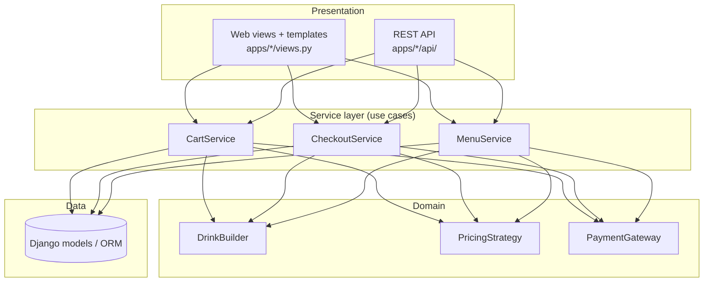
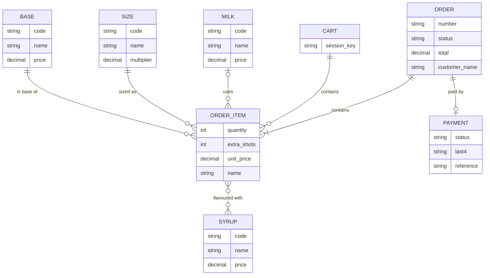
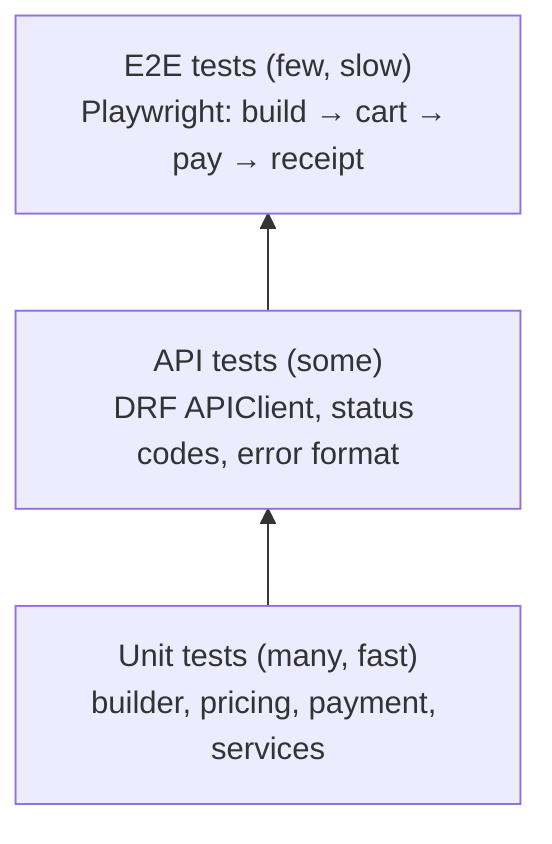

# Morning Cafe — Architecture

A practice web shop where a customer **builds a custom coffee** and **buys it**
with a **fake payment**. No real money, no real cards.

## 1. Goals

| Goal | How we meet it |
|------|----------------|
| Clean separation of concerns | Layered architecture (Presentation → Service → Domain → Data) |
| Business logic is testable without HTTP or a browser | Logic lives in plain Python services/domain classes |
| One source of truth for business rules | Web pages and the REST API both call the **same services** |
| Confidence | Test pyramid: unit → API → Playwright E2E |
| Traceable history | One git branch + commit per step, merged after review |

## 2. Tech stack

| Concern | Choice |
|---------|--------|
| Language | Python 3.14 |
| Web framework | Django 6.1 |
| REST API | Django REST Framework 3.18 |
| Pages | Django templates + a little vanilla JS (live price via the API) + plain CSS |
| Database | SQLite (dev) |
| Tests | pytest, pytest-django, pytest-playwright |
| Code quality | ruff (lint + format) |

## 3. Layered architecture



**Rules**
- Views (web or API) are thin: parse input → call a service → render/serialize output.
- Services contain the use cases and are the only place that writes to the database.
- Domain classes are pure Python (no Django imports where possible) → fast unit tests.
- Lower layers never import from higher layers.

## 4. Design patterns

| Pattern | Where | Why |
|---------|-------|-----|
| **Builder** | `DrinkBuilder` | A coffee is built step by step: base → size → milk → extra shots → syrups. The builder validates each step and produces an immutable `DrinkSpec`. |
| **Strategy** | `PricingStrategy` (`StandardPricing`, `HappyHourPricing`, …) | Price rules can change without touching the builder or the cart. |
| **Strategy + Factory** | `PaymentGateway` (`FakeCardGateway`), created by `get_payment_gateway()` | Checkout depends on an interface, not a concrete gateway. A real gateway could be added later without changing checkout. |
| **Service layer** | `CartService`, `CheckoutService`, `MenuService` | Keeps business logic out of views. Shared by web and API. |
| **Value object** | `DrinkSpec`, `Money` (Decimal-based) | Immutable, comparable, no float rounding bugs. |
| **DTO / Serializer** | DRF serializers | Validates input and shapes output at the API boundary. |

### Builder example (target API)

```python
drink = (
    DrinkBuilder(menu)
    .base("espresso")
    .size("large")
    .milk("oat")
    .extra_shots(1)
    .syrup("vanilla")
    .build()          # -> DrinkSpec, raises ValidationError if invalid
)
price = StandardPricing().price(drink)   # -> Money("5.40")
```

## 5. Domain model



- **Menu** (`Base`, `Size`, `Milk`, `Syrup`) is admin-editable catalogue data.
- **Cart** is tied to the browser session (no login needed).
- **Order** is created at checkout; `unit_price` is copied onto the item so later menu price
  changes don't rewrite history.
- **Order status:** `PENDING → PAID` or `PENDING → FAILED`.

## 6. Fake payment rules

| Card number | Result |
|-------------|--------|
| `4242 4242 4242 4242` | Approved |
| `4000 0000 0000 0002` | Declined |
| Anything failing the Luhn check | Validation error |

Only the last 4 digits are stored. Full card numbers are never saved or logged.

## 7. Web pages

| URL | Page |
|-----|------|
| `/` | Home + menu overview |
| `/build/` | Build your coffee (live price preview) |
| `/cart/` | Cart: change quantity, remove items |
| `/checkout/` | Name + fake card form |
| `/orders/<number>/` | Order confirmation / receipt |

## 8. REST API (`/api/v1/`)

| Method | Endpoint | Purpose |
|--------|----------|---------|
| GET | `/menu/` | All bases, sizes, milks, syrups |
| POST | `/drinks/quote/` | Price a drink spec without saving it |
| GET | `/cart/` | Current cart |
| POST | `/cart/items/` | Add a built drink |
| PATCH | `/cart/items/<id>/` | Change quantity |
| DELETE | `/cart/items/<id>/` | Remove item |
| POST | `/checkout/` | Pay (fake) and create an order |
| GET | `/orders/<number>/` | Order details |

Errors use one format: `{"error": {"code": "...", "message": "...", "fields": {...}}}`.

## 9. Project structure (target)

```
morning-cafe/
├── config/                 # Django project (settings, urls)
├── apps/
│   ├── menu/               # catalogue models, MenuService, admin, seed command
│   ├── drinks/             # DrinkBuilder, DrinkSpec, pricing strategies (pure domain)
│   ├── cart/               # Cart models, CartService
│   ├── orders/             # Order models, CheckoutService
│   ├── payments/           # PaymentGateway interface + FakeCardGateway
│   └── web/                # page views, templates, static (css/js)
├── tests/
│   ├── unit/               # domain + services
│   ├── api/                # DRF endpoint tests
│   └── e2e/                # Playwright browser tests
├── docs/ARCHITECTURE.md
├── requirements.txt
├── pyproject.toml          # pytest + ruff config
└── manage.py
```

## 10. Testing strategy



Key E2E scenarios:
1. Build a coffee, see the live price, add to cart.
2. Change quantity / remove in the cart.
3. Checkout with the approved card → receipt page shows the order number.
4. Checkout with the declined card → error message, cart still intact.

## 11. Delivery plan (one branch + commit per step, approve before merging)

| Step | Branch | Content |
|------|--------|---------|
| 1 | `step-1-architecture` | This document, `.gitignore` |
| 2 | `step-2-project-setup` | Settings cleanup (env secret key), `apps/` skeleton, requirements, pytest + ruff config |
| 3 | `step-3-menu` | Menu models, admin, migrations, `seed_menu` command, tests |
| 4 | `step-4-domain` | `DrinkBuilder`, `DrinkSpec`, `Money`, pricing strategies + unit tests |
| 5 | `step-5-cart-checkout` | Cart/Order models, services, fake payment gateway + tests |
| 6 | `step-6-api` | REST API + API tests |
| 7 | `step-7-web` | Pages, templates, CSS, JS live price |
| 8 | `step-8-e2e` | Playwright E2E tests |
| 9 | `step-9-polish` | README, CI (GitHub Actions), final cleanup |
