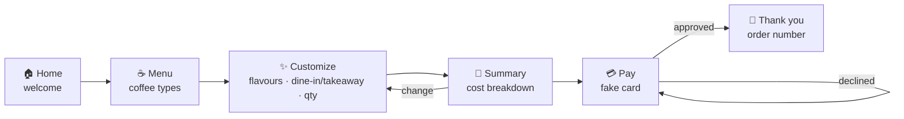
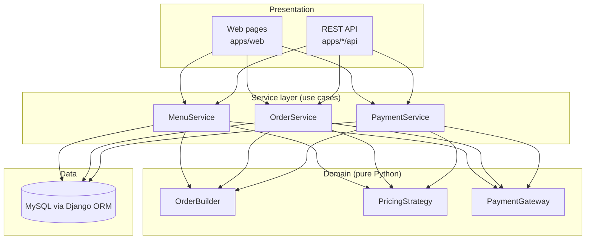
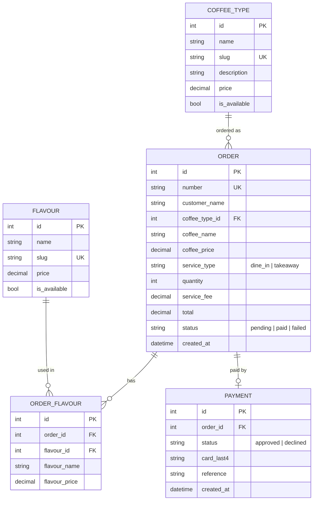
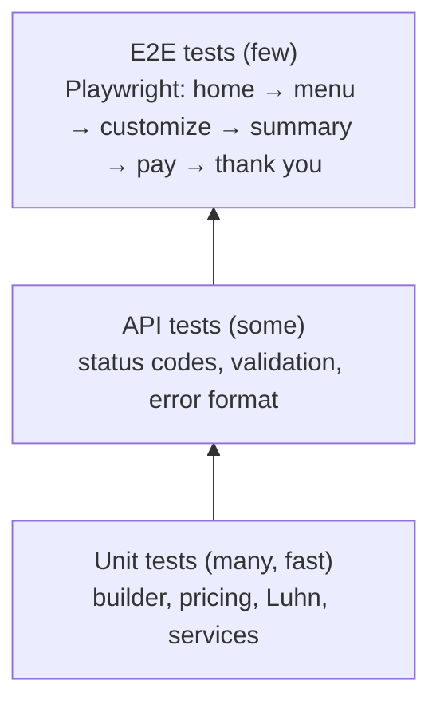
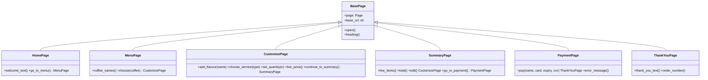

# Morning Cafe — Architecture

A practice web shop: the customer is welcomed, browses the coffee menu, picks a
coffee, optionally adds flavours, chooses **dine-in or takeaway**, sees the cost,
pays with a **fake card**, and gets a thank-you page. No real money, no real cards.

## 1. Customer journey



| # | URL | Page | What happens |
|---|-----|------|--------------|
| 1 | `/` | **Home** | Welcome message, short intro, "See our menu" button |
| 2 | `/menu/` | **Menu** | Coffee types from the database (name, description, price) |
| 3 | `/order/<coffee>/` | **Customize** | Optional flavours (multi-select), dine-in or takeaway, quantity. Price updates live. |
| 4 | `/order/summary/` | **Summary** | Line-by-line cost: coffee, flavours, takeaway cup fee, total |
| 5 | `/order/pay/` | **Pay** | Name + fake card form |
| 6 | `/thank-you/<number>/` | **Thank you** | "Thank you, Sara!" + order number + what was ordered |

The draft order (steps 3–4) is kept in the browser session. It is saved to the
database as an `Order` only when the customer goes to pay.

## 2. Tech stack

| Concern | Choice |
|---------|--------|
| Language | Python 3.14 |
| Web framework | Django 6.1 |
| REST API | Django REST Framework 3.18 |
| Pages | Django templates + small vanilla JS (live price via the API) + plain CSS |
| Database | **MySQL 8** (driver `mysqlclient`), configured through environment variables. SQLite fallback for quick local runs. |
| Tests | pytest, pytest-django, pytest-playwright |
| Code quality | ruff (lint + format) |

### Database configuration

Settings read from environment variables (`.env`, never committed):

```
DB_ENGINE=mysql          # or sqlite
DB_NAME=morning_cafe
DB_USER=cafe
DB_PASSWORD=...
DB_HOST=127.0.0.1
DB_PORT=3306
```

The MySQL user needs `CREATE` rights so pytest can create the `test_morning_cafe` database.

## 3. Layered architecture



**Rules**
- Views (web or API) are thin: read input → call a service → render/serialize.
- Services hold the use cases and are the only code that writes to the database.
- Domain classes are plain Python → fast unit tests, no database needed.
- Lower layers never import higher layers.

## 4. Design patterns

### 4.1 Architectural pattern: MVT + Service Layer

The most common setup in professional Django projects today is Django's own
**MVT** (Model–View–Template, Django's version of MVC) plus a **Service Layer**:

| Piece | Responsibility |
|-------|----------------|
| **Model** | Tables and simple data rules (Django ORM) |
| **View** | HTTP only: read request → call service → return response |
| **Template** | HTML rendering |
| **Service** | All business logic / use cases ("create order", "pay order") |

We deliberately do **not** add a separate Repository layer: Django's ORM
(models + managers/querysets) already plays that role, and wrapping it again is a
common source of over-engineering in Django codebases.

### 4.2 Design patterns in the application code

| Pattern | Where | Why |
|---------|-------|-----|
| **Builder** | `OrderBuilder` | The order is assembled step by step: coffee → flavours → service type → quantity → `build()`. Each step is validated; the result is an immutable `OrderDraft`. |
| **Strategy** | `PricingStrategy`: `DineInPricing`, `TakeawayPricing` | Dine-in and takeaway are priced differently (takeaway adds a cup fee). New rules (e.g. happy hour) = new class, no changes elsewhere. |
| **Factory** | `pricing_for(service_type)`, `get_payment_gateway()` | Picks the right strategy/gateway so callers don't use `if/else` chains. |
| **Strategy (gateway)** | `PaymentGateway` interface → `FakeCardGateway` | Payment depends on an interface; a real provider could be added later. |
| **Service layer** | `MenuService`, `OrderService`, `PaymentService` | Business logic in one place, shared by pages and API. |
| **Value objects** | `Money` (Decimal), `OrderDraft` | Immutable, no float rounding errors. |
| **DTO** | DRF serializers | Validate input and shape output at the API boundary. |

### Target code

```python
draft = (
    OrderBuilder(menu)
    .coffee("cappuccino")
    .add_flavour("vanilla")
    .add_flavour("caramel")
    .service("takeaway")
    .quantity(2)
    .build()  # -> OrderDraft, raises ValidationError if invalid
)
quote = pricing_for(draft.service).quote(draft)
# quote.lines -> [("Cappuccino", 3.50), ("Vanilla", 0.50), ("Caramel", 0.50), ("Takeaway cup", 0.30)]
# quote.total -> Money("9.60")    # (3.50 + 0.50 + 0.50 + 0.30) × 2
```

## 5. Pricing rules

| Item | Rule |
|------|------|
| Coffee | Price from the menu (`CoffeeType.price`) |
| Flavour | Each selected flavour adds its price (`Flavour.price`); 0–3 flavours allowed |
| Dine-in | No extra fee |
| Takeaway | + cup fee per drink (setting `TAKEAWAY_CUP_FEE`, default 0.30) |
| Quantity | 1–10, multiplies the per-drink price |

Prices are copied onto the order at checkout so later menu changes don't rewrite old orders.

## 6. Data model (MySQL tables)



**Seed data** (`python manage.py seed_menu`):
- Coffees: Espresso, Americano, Cappuccino, Latte, Flat White, Mocha
- Flavours: Vanilla, Caramel, Hazelnut, Cinnamon

## 7. Fake payment rules

| Card number | Result |
|-------------|--------|
| `4242 4242 4242 4242` | Approved → order `paid` → thank-you page |
| `4000 0000 0000 0002` | Declined → order `failed`, error shown, customer can retry |
| Fails Luhn check / bad expiry / bad CVC | Form validation error |

Only the last 4 digits are stored. Full card numbers are never saved or logged.

## 8. REST API (`/api/v1/`)

| Method | Endpoint | Purpose |
|--------|----------|---------|
| GET | `/coffees/` | Available coffee types |
| GET | `/flavours/` | Available flavours |
| POST | `/orders/quote/` | Price a draft (used for the live price) — nothing saved |
| POST | `/orders/` | Create a pending order |
| POST | `/orders/<number>/pay/` | Fake payment |
| GET | `/orders/<number>/` | Order details |

Errors use one format: `{"error": {"code": "...", "message": "...", "fields": {...}}}`.

## 9. Project structure (target)

```
morning-cafe/
├── config/                 # settings (env-driven, MySQL), urls
├── apps/
│   ├── menu/               # CoffeeType, Flavour, MenuService, admin, seed_menu
│   ├── ordering/           # OrderBuilder, OrderDraft, Money, pricing strategies (domain)
│   ├── orders/             # Order, OrderFlavour models, OrderService
│   ├── payments/           # PaymentGateway, FakeCardGateway, Payment model, PaymentService
│   └── web/                # page views, templates, static css/js
├── tests/
│   ├── unit/               # domain + services
│   ├── api/                # DRF endpoint tests
│   └── e2e/                # Playwright browser tests
├── docs/ARCHITECTURE.md
├── .env.example
├── requirements.txt
├── pyproject.toml          # pytest + ruff config
└── manage.py
```

## 10. Testing strategy



### 10.1 Playwright: Page Object Model (POM)

Every page of the site has one **page object** class. Tests never touch selectors
directly; they talk to page objects in business language.



**POM rules**
- **Locators live only in page objects**, using `get_by_role` / `get_by_label` first,
  and `data-testid` attributes when there is no accessible name.
- **Actions that navigate return the next page object** (fluent flow), e.g.
  `HomePage(page).open().go_to_menu().choose("Latte")`.
- **No assertions inside page objects.** They return data; tests assert with
  Playwright's `expect` or plain `assert`.
- **Test data in one place** (`tests/e2e/data.py`: cards, customer names).
- **Fixtures** (`tests/e2e/conftest.py`) seed the menu into the test DB and give each
  test a fresh `home_page` object pointing at Django's `live_server`.

Example test:

```python
def test_takeaway_order_with_flavours(home_page):
    summary = (
        home_page.open()
        .go_to_menu()
        .choose("Cappuccino")
        .add_flavour("Vanilla")
        .choose_service("Takeaway")
        .set_quantity(2)
        .continue_to_summary()
    )
    assert summary.total() == "€8.60"

    thank_you = summary.go_to_payment().pay("Sara", APPROVED_CARD, "12/30", "123")
    expect(thank_you.heading()).to_have_text("Thank you, Sara!")
```

E2E folder layout:

```
tests/e2e/
├── conftest.py            # live_server, seeded menu, page-object fixtures
├── data.py                # test cards, customer names
├── pages/
│   ├── base_page.py
│   ├── home_page.py
│   ├── menu_page.py
│   ├── customize_page.py
│   ├── summary_page.py
│   ├── payment_page.py
│   └── thank_you_page.py
├── test_home_and_menu.py
├── test_customize.py
└── test_checkout.py
```

Key Playwright scenarios:
1. Home shows the welcome message; "See our menu" opens the menu.
2. Menu lists the coffee types from the database.
3. Pick a coffee, add flavours, switch dine-in ↔ takeaway → price updates live.
4. Summary shows the correct line items and total.
5. Pay with the approved card → thank-you page with name and order number.
6. Pay with the declined card → error message, can retry.

## 11. Delivery plan (one branch + commit per step, approve before merging)

| Step | Branch | Content |
|------|--------|---------|
| 1 | `step-1-architecture` | This document, `.gitignore` |
| 2 | `step-2-project-setup` | Env-based settings, MySQL config + `.env.example`, `apps/` skeleton, requirements, pytest + ruff |
| 3 | `step-3-menu` | `CoffeeType`, `Flavour` models, admin, migrations, `seed_menu`, tests |
| 4 | `step-4-domain` | `OrderBuilder`, `OrderDraft`, `Money`, pricing strategies + unit tests |
| 5 | `step-5-orders-payments` | Order/Payment models, services, fake gateway + tests |
| 6 | `step-6-api` | REST API + API tests |
| 7 | `step-7-web` | Home, Menu, Customize, Summary, Pay, Thank-you pages |
| 8 | `step-8-e2e` | Playwright E2E tests |
| 9 | `step-9-polish` | README, CI (GitHub Actions with a MySQL service), cleanup |
